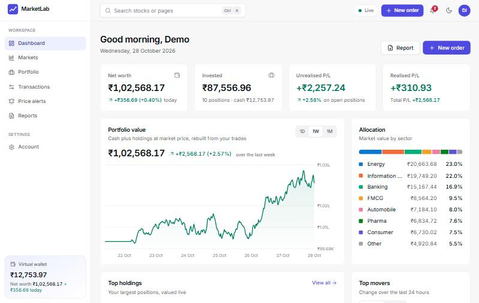
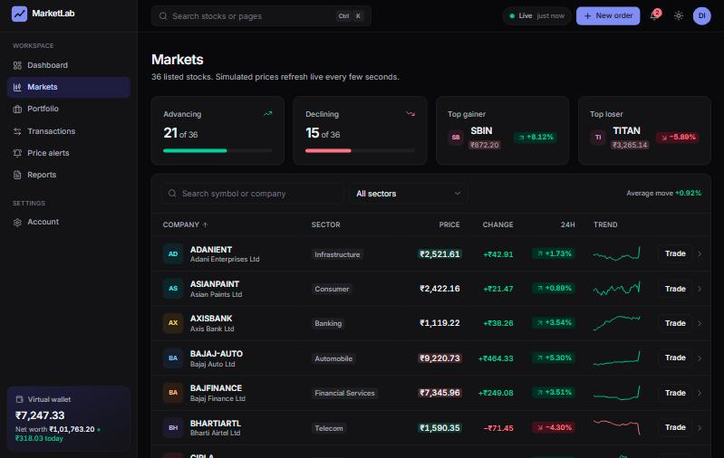
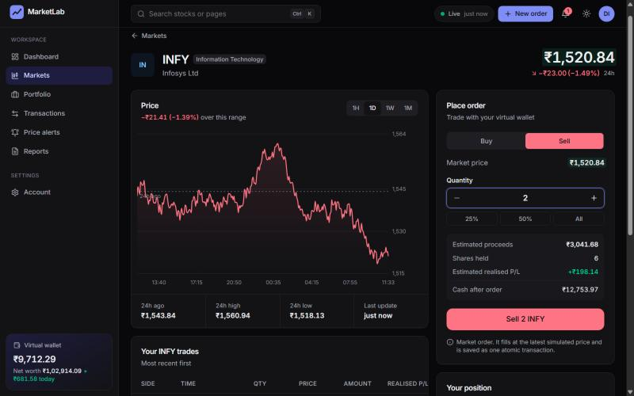
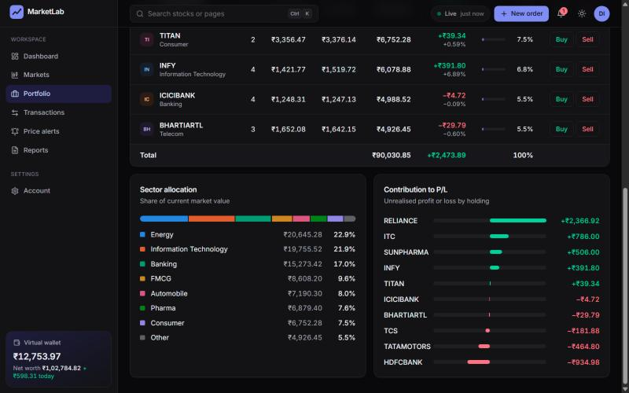
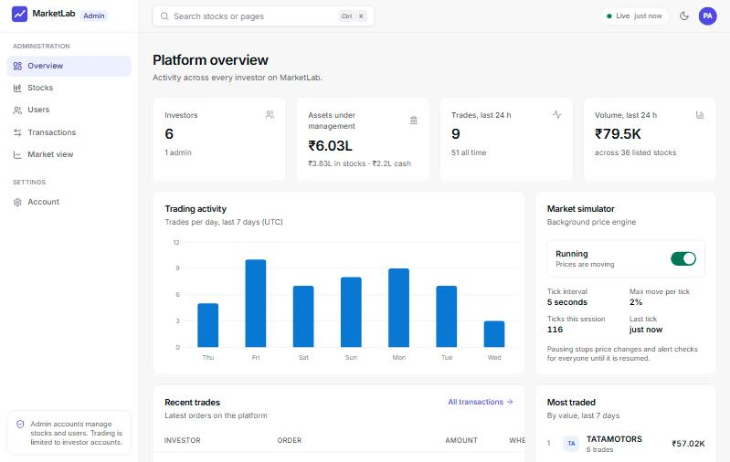
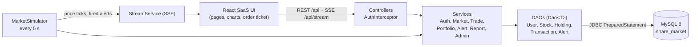

# MarketLab: Share Market Portfolio Management System

A simulated share market with a virtual wallet and a self-valuing portfolio, built as the
Software Engineering Laboratory course-based project (25PC2CS202). Investors practise buying
and selling with ₹1,00,000 of virtual cash while a background simulator moves prices every
five seconds. Admins manage the listed stocks and the user base.

The project follows the layered design in the CBP document (service classes, one DAO per
table over JDBC `PreparedStatement`, atomic trades, a price simulator thread, MySQL 8 with a
view and a trigger). The interface is a web SaaS dashboard instead of Swing screens, the
"web front end using Spring Boot REST APIs on the same database" listed under Future
Enhancements in the document.



| Markets (live prices) | Stock page and order ticket |
|---|---|
|  |  |
| **Portfolio** | **Admin overview** |
|  |  |

## Features

| CBP objective | Where it lives |
|---|---|
| 1. Secure registration and role-based access | Register and sign-in pages, salted SHA-256 hashes (`PasswordUtil`), HttpOnly session cookie, `AuthInterceptor` (Investor and Admin areas) |
| 2. Realistic simulated market | `MarketSimulator` on a `ScheduledExecutorService`, bounded random walk (max ±2% per tick), full `price_history`, live updates over server-sent events |
| 3. Validated buying and selling | `TradeService.buy/sell`: balance and quantity checks, one JDBC transaction per trade, `InsufficientFundsException` / `InsufficientQuantityException` |
| 4. Portfolio with profit and loss | `portfolio_view`, average buy price, market value, unrealised P/L, realised P/L replayed from history (`RealisedLedger`), live revaluation in the browser |
| 5. Complete transaction history | Transactions page filtered by stock, type and date, paginated, CSV export |
| 6. Market trends and price alerts | Price charts (1H, 1D, 1W, 1M), top gainers and losers, ABOVE/BELOW alerts checked on every tick with in-app notifications |
| 7. Portfolio reports | Report preview plus CSV and PDF export (OpenPDF) |
| 8. Normalised, consistent database | Six tables in 3NF, PK/FK/UNIQUE/CHECK constraints, `portfolio_view`, `trg_price_log`, indexes, ACID transactions |
| 9. Maintainable, testable architecture | Controller, service and DAO layers, generic `Dao<T>`, custom exceptions, 51 JUnit 5 tests (unit and MySQL integration) |

Also included: a portfolio value chart rebuilt from your trades, sector allocation, a
Ctrl+K command palette, light and dark themes, a responsive layout down to phone width, and
an admin switch to pause or resume the simulator.

## Tech stack

| Layer | Technology |
|---|---|
| Backend | Java 17, Spring Boot 3.3 (web layer only), hand-written JDBC DAOs, HikariCP |
| Database | MySQL 8.0 via MySQL Connector/J |
| Reports | OpenPDF (PDF), plain Java (CSV) |
| Frontend | React 18, TypeScript, Vite, Tailwind CSS, TanStack Query, Recharts, lucide icons |
| Tests | JUnit 5 |

## Architecture



A trade runs on one connection with `autoCommit` off: lock the user row, check the balance
or holding, update the wallet, insert or update the holding, insert the transaction, then
commit. Any failure rolls everything back, which an integration test verifies by forcing a
failure after the wallet is debited.

## Project structure

```
share-market-portfolio/
├── backend/                      Spring Boot application (com.sharemarket)
│   ├── src/main/java/com/sharemarket/
│   │   ├── web/                  REST controllers, auth interceptor, error handler
│   │   ├── service/              business rules, P/L maths, SSE stream
│   │   ├── dao/                  Dao<T> and one DAO per table
│   │   ├── model/                User, Stock, Holding, Portfolio, Transaction, PriceAlert, enums
│   │   ├── simulator/            MarketSimulator and its scheduler
│   │   ├── util/                 DBConnection, PasswordUtil, Session, CSV/PDF exporters
│   │   ├── exception/            business-rule exceptions
│   │   ├── seed/                 schema runner and demo data
│   │   └── config/               DataSource
│   ├── src/main/resources/db/    01_schema.sql, 02_views_triggers.sql, 03_sample_stocks.sql
│   ├── src/test/java/            unit and integration tests
│   └── db.properties.example     copy to db.properties
├── frontend/                     React app (src/pages, src/components, src/lib)
├── scripts/                      build, run and local MySQL helpers (Windows)
└── docs/screenshots/
```

## Getting started

### Prerequisites

- JDK 17 or newer (JDK 23 works). `java` on PATH can stay at Java 8; the scripts find a JDK
  under `C:\Program Files\Java` or use `JAVA_HOME`.
- Node.js 18 or newer
- MySQL 8.0

Maven is not needed: the project ships the Maven wrapper (`mvnw`).

### 1. Point the app at MySQL

Pick one:

- **Your own MySQL server.** Copy `backend/db.properties.example` to `backend/db.properties`
  and set `db.url`, `db.user` and `db.password`. The database is created automatically.
- **A throwaway private instance.** Run `scripts\start-local-mysql.cmd`. It starts MySQL 8 on
  port 3307 with its data in `.localdb/` (root, no password), without touching an installed
  MySQL service. Then use this `backend/db.properties`:

  ```properties
  db.url=jdbc:mysql://localhost:3307/share_market
  db.user=root
  db.password=
  ```

On first start the app creates the tables, view and triggers, loads 36 sample stocks, generates
a week of price history and creates the demo accounts.

### 2a. Run it as one jar

```bash
scripts\build.cmd
```

```bash
scripts\run.cmd
```

Open http://localhost:8080.

### 2b. Or run in development mode (hot reload)

```bash
cd backend && mvnw.cmd spring-boot:run
```

```bash
cd frontend && npm install && npm run dev
```

Open http://localhost:5180. Vite proxies `/api` to the backend on port 8080.

### Demo accounts

| Role | Email | Password |
|---|---|---|
| Investor (with trades, holdings and alerts) | `demo@marketlab.dev` | `Demo@1234` |
| Admin | `admin@marketlab.dev` | `Admin@123` |

The sign-in page has one-click buttons for both. Five more sample investors exist so the
admin views have data. Turn the demo data off with `app.seed.demo=false`.

## Tests

```bash
cd backend && mvnw.cmd test
```

- **Unit tests:** average-price and P/L formulas, the realised P/L replay, password hashing,
  the SQL script runner (DELIMITER blocks), Indian number formatting, CSV escaping and the
  simulator's ±2% bound.
- **Integration tests** run against a separate `share_market_test` database: a successful
  buy and sell, re-averaging, rejected orders leaving data unchanged, rollback after a
  mid-trade failure, the price trigger, the balance CHECK constraint, cascade delete and
  alert firing. They default to `localhost:3307` (root, no password) and are skipped when
  MySQL is unreachable. Point them elsewhere with
  `-Dtest.db.url=... -Dtest.db.user=... -Dtest.db.password=...`.

## Database

The scripts in `backend/src/main/resources/db/` run unchanged in MySQL Workbench.

| Table | Purpose | Key constraints |
|---|---|---|
| `users` | accounts, role, wallet balance | UNIQUE email, CHECK balance ≥ 0, role IN (INVESTOR, ADMIN) |
| `stocks` | listed stocks and current price | UNIQUE symbol, CHECK price > 0 |
| `holdings` | one row per user per stock | UNIQUE (user_id, stock_id), CHECK quantity ≥ 0, FK cascade on user |
| `transactions` | every BUY and SELL | CHECK type, quantity > 0, price > 0, index (user_id, txn_time) |
| `price_alerts` | ABOVE/BELOW targets | CHECK condition, target > 0 |
| `price_history` | every price tick | index (stock_id, recorded_at) |

- `portfolio_view` joins holdings with live prices to give invested amount, market value
  and unrealised P/L, so portfolio value is never stored.
- `trg_price_log` writes a `price_history` row whenever `stocks.current_price` changes.
  `trg_price_log_insert` logs a new stock's listing price.
- Money columns are `DECIMAL(12,2)`. Times are stored in UTC.
- Ticks older than 30 days are archived automatically (`simulator.history.retention.days`).

## Configuration (`backend/db.properties`)

| Key | Default | Meaning |
|---|---|---|
| `db.url` | `jdbc:mysql://localhost:3306/share_market` | JDBC URL (needed options are added automatically) |
| `db.user` / `db.password` | `root` / empty | MySQL credentials |
| `simulator.interval.seconds` | `5` | price tick interval |
| `simulator.max.change.percent` | `2` | maximum move per tick |
| `wallet.initial.balance` | `100000` | starting cash for new investors |
| `simulator.enabled` | `true` | start the simulator running |
| `app.seed.demo` | `true` | create demo investors on an empty database |

## REST API

All routes are under `/api`. Errors return `{status, code, message}`.

| Method and path | Access | Purpose |
|---|---|---|
| `POST /auth/register`, `POST /auth/login`, `POST /auth/logout` | public | account and session |
| `GET /auth/me`, `POST /auth/password` | signed in | current user, change password |
| `GET /market/stocks`, `/market/stocks/{symbol}` | signed in | live quotes with 24 h change, high, low |
| `GET /market/stocks/{symbol}/history?range=1H\|1D\|1W\|1M` | signed in | price chart data |
| `GET /market/movers`, `/market/sparklines`, `/market/status` | signed in | gainers and losers, trend lines, simulator state |
| `GET /stream` | signed in | server-sent events: `tick`, `alert` |
| `POST /trade/buy`, `POST /trade/sell` | investor | place an order `{symbol, quantity}` |
| `GET /portfolio`, `/portfolio/performance`, `/portfolio/transactions` | investor | holdings and P/L, value history, filtered history |
| `GET/POST /alerts`, `DELETE /alerts/{id}` | investor | price alerts |
| `GET /reports/portfolio`, `/reports/portfolio/export?format=csv\|pdf` | investor | report data and downloads |
| `GET /admin/stats`, `/admin/users`, `/admin/transactions` | admin | platform overview, users, all trades |
| `POST /admin/stocks`, `PUT /admin/stocks/{id}`, `DELETE /admin/stocks/{id}` | admin | manage listed stocks |
| `DELETE /admin/users/{id}`, `GET/POST /admin/simulator` | admin | remove a user, pause or resume prices |

## Differences from the CBP document

- **Web UI instead of Swing.** Each Swing frame maps to a page (Login, Register, Dashboard,
  Markets/Trade, Portfolio, History, Alerts, Reports, Admin). Controllers stand in for the
  frames, and each still calls one service method.
- **Salted SHA-256.** Passwords are hashed with SHA-256 as specified, plus a random per-user
  salt (`sha256$salt$hash`). Plain unsalted SHA-256 hashes are still accepted.
- **Schema additions.** `price_alerts.triggered_at` records when an alert fired.
  `holdings.avg_buy_price` keeps 4 decimals so repeated averaging does not drift. An
  insert trigger logs a new stock's first price.
- **Sessions.** The `Session` object lives server-side behind an HttpOnly cookie, so the
  browser never sees the user id or role directly.

Prices are simulated for learning and are not real market data.
